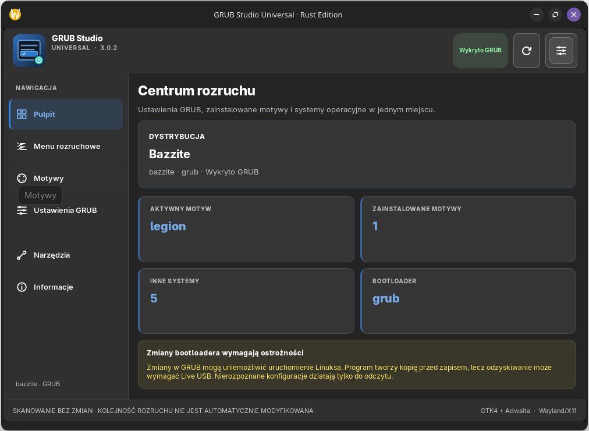
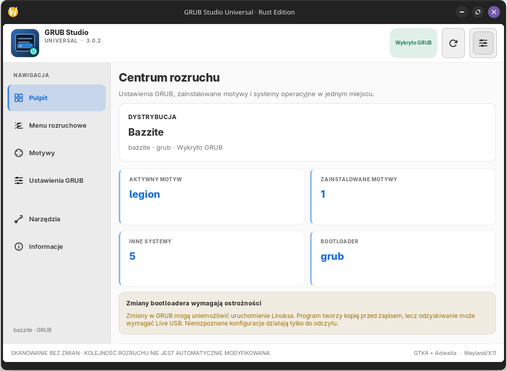

<p align="center">
  
</p>

<h1 align="center">GRUB Studio Universal</h1>

<p align="center">
  <strong>Twoje centrum zarządzania GRUB — bez terminala.</strong><br />
  A clean, native GRUB configuration studio for Linux.
</p>

<p align="center">
  <a href="https://github.com/wolfgangxxiii/GRUB-Studio-Universal/releases/tag/v3.0.2-rc.1"></a>
  <a href="https://github.com/wolfgangxxiii/GRUB-Studio-Universal/actions/workflows/test-and-build.yml"></a>
  
  
  <a href="LICENSE"></a>
</p>

<p align="center">
  <a href="https://github.com/wolfgangxxiii/GRUB-Studio-Universal/releases/download/v3.0.2-rc.1/GRUB-Studio-Universal-v3.0.2-x86_64.AppImage"><strong>⬇️ Pobierz AppImage / Download · v3.0.2</strong></a>
  &nbsp;·&nbsp;
  <a href="#polski">🇵🇱 Polski</a>
  &nbsp;·&nbsp;
  <a href="#english">🇬🇧 English</a>
</p>

---

## 🖥️ Poznaj aplikację / Take a look

<p align="center">
  <a href="docs/screenshots/dashboard-dark.png">
    
  </a>
</p>

<p align="center"><sub>🌙 Tryb ciemny · Dark appearance · Kliknij, aby powiększyć / Click to enlarge</sub></p>

<details>
  <summary><strong>☀️ Zobacz tryb jasny / View light appearance</strong></summary>
  <br />
  <p align="center">
    <a href="docs/screenshots/dashboard-light.png">
      
    </a>
  </p>
</details>

<p align="center"><sub>Rzeczywiste zrzuty okna wersji 3.0.2, przycięte do obszaru aplikacji. / Real, cropped screenshots of version 3.0.2.</sub></p>

| 🎨 Personalizacja | 🛡️ Bezpieczna obsługa | ⚡ Natywny interfejs |
| :--- | :--- | :--- |
| Import motywów z **ZIP, TAR.GZ, TAR.XZ** lub folderu; jasny i ciemny wygląd. | Oddzielny proces Polkit, kontrola ścieżek, kopie zapasowe i weryfikacja konfiguracji. | **Rust + GTK4 + libadwaita**, Wayland/X11 i siedem języków. |

---

<a id="polski"></a>

## 🇵🇱 Polski

### Co umożliwia GRUB Studio?

GRUB Studio Universal pomaga przeglądać stan rozruchu, instalować motywy GRUB i bezpiecznie zmieniać obsługiwane ustawienia. Aplikacja nie zastępuje bootloadera ani nie zmienia kolejności rozruchu UEFI.

| Funkcja | Co możesz zrobić |
| :--- | :--- |
| **Pulpit** | Sprawdzić wykrytą dystrybucję, aktywny motyw, liczbę motywów, inne systemy i bootloader. |
| **Menu rozruchowe** | Przeglądać wykryte wpisy GRUB/EFI; zarządzać własnymi wpisami EFI tam, gdzie pozwala konfiguracja. |
| **Motywy** | Wykrywać motywy, importować katalogi i archiwa, aktywować lub wyłączać wybrany motyw. |
| **Ustawienia GRUB** | Zmieniać obsługiwane parametry czasu menu, trybu wyświetlania, rozdzielczości i jądra. |
| **Narzędzia** | Tworzyć i przywracać kopie konfiguracji oraz przeglądać dziennik operacji. |
| **Wygląd i język** | Wybierać motyw systemowy/jasny/ciemny; korzystać z siedmiu języków interfejsu. |

### 📦 Instalowanie AppImage

**[Pobierz GRUB Studio Universal 3.0.2 — AppImage x86_64](https://github.com/wolfgangxxiii/GRUB-Studio-Universal/releases/download/v3.0.2-rc.1/GRUB-Studio-Universal-v3.0.2-x86_64.AppImage)**

AppImage nie wymaga instalowania pakietu w systemie. Po pobraniu:

```bash
chmod +x GRUB-Studio-Universal-v3.0.2-x86_64.AppImage
./GRUB-Studio-Universal-v3.0.2-x86_64.AppImage
```

[Suma kontrolna SHA-256](https://github.com/wolfgangxxiii/GRUB-Studio-Universal/releases/download/v3.0.2-rc.1/GRUB-Studio-Universal-v3.0.2-SHA256.txt) · [Historia wydań](https://github.com/wolfgangxxiii/GRUB-Studio-Universal/releases)

### 🎨 Skąd pobierać motywy GRUB?

| Galeria | Zawartość |
| :--- | :--- |
| **[Gorgeous-GRUB](https://github.com/jacksaur/Gorgeous-GRUB)** | Kolekcja motywów tworzonych przez społeczność, z odnośnikami do autorów. |
| **[Distro GRUB Themes](https://k1ng.dev/distro-grub-themes/preview)** | Podglądy i pliki motywów przeznaczonych dla różnych dystrybucji. |

**Import bez rozpakowywania ręcznego:**

1. Pobierz archiwum **`.zip`**, **`.tar.gz`** lub **`.tar.xz`** z wybranym motywem.
2. Otwórz **Motywy → Importuj archiwum**. Program znajdzie `theme.txt`, także wewnątrz folderów.
3. Sprawdź wykrytą nazwę, liczbę plików i rozmiar. Zatwierdź instalację, a następnie autoryzację Polkit.
4. Wybierz zainstalowany motyw i kliknij **Zastosuj motyw** — import nie aktywuje go automatycznie.

Wciąż możesz użyć przycisku **Importuj folder**. Jeśli archiwum zawiera *kilka* niezależnych plików `theme.txt`, rozpakuj je i wybierz katalog konkretnego motywu. Program nie wykonuje skryptów z archiwów; kontroluje niebezpieczne ścieżki, dowiązania, typy plików i limit rozmiaru.

### 🔐 Bezpieczeństwo i zgodność

- Uruchamiaj aplikację **jako zwykły użytkownik**. Zmiany wymagają osobnej autoryzacji **Polkit**; bez niej dostępny jest tryb tylko do odczytu.
- Konfiguracja jest generowana do pliku tymczasowego i sprawdzana przed zastąpieniem `grub.cfg`. Program nie uruchamia `grub-install`.
- Obsługiwane profile obejmują **Bazzite, Fedora, Ubuntu/Debian, Arch/CachyOS i openSUSE**; dostępne operacje zależą od wykrytej konfiguracji.
- W środowiskach z aktywnym **Limine, systemd-boot lub rEFInd** zapis jest ograniczony. Zmiany wyglądu GRUB na Bazzite/OSTree nie są oficjalnie wspierane przez Bazzite.
- **Przed modyfikacją rozruchu wykonaj kopię konfiguracji i przygotuj nośnik ratunkowy.** Testy automatyczne nie zastępują testu zapisu na rzeczywistym urządzeniu.

---

<a id="english"></a>

## 🇬🇧 English

### What can it do?

**GRUB Studio Universal** is a native Rust/GTK4 desktop app for inspecting the boot setup, managing GRUB themes and safely editing supported settings. It does **not** replace your bootloader or modify UEFI boot order.

| Feature | Details |
| :--- | :--- |
| **Dashboard** | View detected distribution, active theme, installed themes, other systems and bootloader. |
| **Boot entries** | Inspect GRUB/EFI records and manage custom EFI entries on supported configurations. |
| **Themes** | Detect, import, apply and disable GRUB themes; import folders or ZIP/TAR.GZ/TAR.XZ archives. |
| **GRUB settings** | Configure supported timeout, menu style, resolution and kernel options. |
| **Tools** | Create and restore configuration backups; review the operation log. |
| **Appearance** | System/light/dark modes, native libadwaita styling and seven interface languages. |

### 📦 Download & run

**[Download GRUB Studio Universal 3.0.2 AppImage (x86_64)](https://github.com/wolfgangxxiii/GRUB-Studio-Universal/releases/download/v3.0.2-rc.1/GRUB-Studio-Universal-v3.0.2-x86_64.AppImage)**

```bash
chmod +x GRUB-Studio-Universal-v3.0.2-x86_64.AppImage
./GRUB-Studio-Universal-v3.0.2-x86_64.AppImage
```

[SHA-256 checksum](https://github.com/wolfgangxxiii/GRUB-Studio-Universal/releases/download/v3.0.2-rc.1/GRUB-Studio-Universal-v3.0.2-SHA256.txt) · [All releases](https://github.com/wolfgangxxiii/GRUB-Studio-Universal/releases)

### 🎨 Find and import themes

- [Gorgeous-GRUB](https://github.com/jacksaur/Gorgeous-GRUB) — curated community theme collection.
- [Distro GRUB Themes](https://k1ng.dev/distro-grub-themes/preview) — distribution-themed designs with previews and downloads.

Download a **ZIP**, **TAR.GZ** or **TAR.XZ** file and select **Themes → Import archive**. The application finds one `theme.txt`, including nested directories, extracts supported theme assets in a private, **unprivileged** temporary directory, validates them, and asks for confirmation **before** Polkit authorization. Installation never activates the theme automatically. Use **Import folder** for already extracted themes; extract archives containing multiple themes manually and select the intended directory. Installer scripts are skipped and never executed.

### 🔐 Safety & compatibility

- Run the GUI as a **regular user**. Administrative operations use a separate **Polkit** helper, and unsupported installations remain read-only.
- Generated GRUB configuration is validated before atomically replacing the existing output. No `grub-install` or UEFI boot-order changes are performed.
- Supported detection includes **Bazzite, Fedora, Ubuntu/Debian, Arch/CachyOS and openSUSE**, with write permissions dependent on the actual boot profile.
- Write actions are restricted when **Limine, systemd-boot or rEFInd** is active. Bazzite does not officially support custom GRUB appearance changes.
- **Back up your boot configuration and keep a recovery USB drive available.** Real hardware/Polkit testing is still recommended.

---

## 🧰 Building from source / Kompilacja

<details>
  <summary><strong>Show build instructions / Pokaż instrukcje</strong></summary>

Install the Rust toolchain, GTK4/libadwaita development headers, GCC and `pkg-config` (e.g. inside Fedora Toolbox), then run:

```bash
cargo test --all-targets
cargo build --release --bins
cargo run --bin grub-studio-universal -- --demo
```

The AppImage packaging script also requires `linuxdeploy` and `rsvg-convert`:

```bash
bash build-appimage.sh
```

Automated Rust tests, GTK4 UI smoke tests, preference switching, live resize, screenshots and AppImage checks run in [GitHub Actions](https://github.com/wolfgangxxiii/GRUB-Studio-Universal/actions). See [docs/DESIGN.md](docs/DESIGN.md) for the application layout and design notes.

</details>

---

<p align="center">
  Found a bug? <a href="https://github.com/wolfgangxxiii/GRUB-Studio-Universal/issues">Open an issue</a> ·
  <a href="LICENSE">GPL-3.0-or-later</a> ·
  Independent community project, not affiliated with GNU GRUB or Bazzite.
</p>
