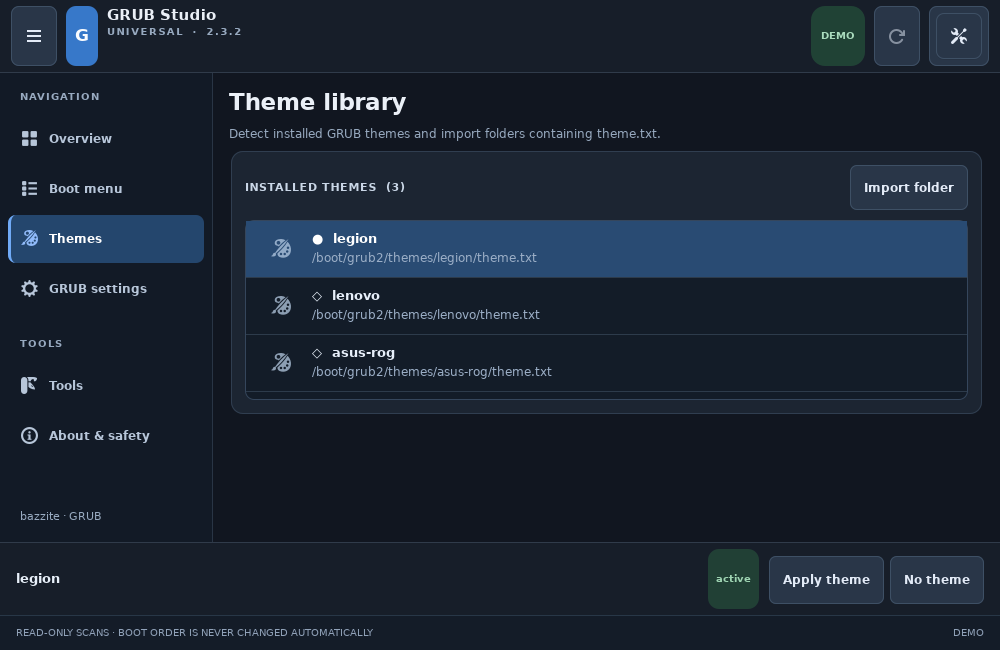
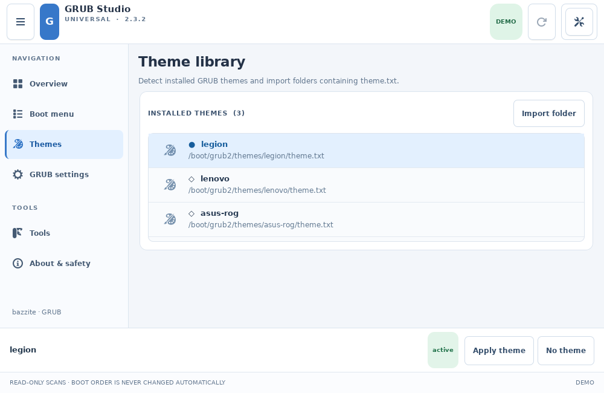

<p align="center">
  
</p>

<h1 align="center">GRUB Studio Universal</h1>

<p align="center">
  <strong>A modern, portable GRUB configuration studio for Linux.</strong><br>
  Rust · GTK4 · Wayland · Light & Dark
</p>

<p align="center">
  <a href="#polski">🇵🇱 Polski</a> &nbsp;·&nbsp; <a href="#english">🇬🇧 English</a>
</p>

<p align="center">
  <a href="https://github.com/wolfgangxxiii/GRUB-Studio-Universal/actions/workflows/test-and-build.yml"></a>
  
  
  
  <a href="LICENSE"></a>
</p>

<p align="center">
  <a href="https://github.com/wolfgangxxiii/GRUB-Studio-Universal/releases/download/v2.3.3-rc.1/GRUB-Studio-Universal-v2.3.3-x86_64.AppImage"><strong>⬇️ Download AppImage · v2.3.3 RC1</strong></a>
  &nbsp;·&nbsp;
  <a href="https://github.com/wolfgangxxiii/GRUB-Studio-Universal/releases">All releases</a>
</p>

<p align="center">
  
  
</p>
<p align="center"><sub>Rzeczywiste zrzuty GTK4 / Actual GTK4 screenshots · tryb demonstracyjny / demo mode</sub></p>

---

<a id="polski"></a>

## 🇵🇱 Polski

**GRUB Studio Universal** to graficzne narzędzie do zarządzania konfiguracją programu rozruchowego GRUB. Powstało w **Rust** i korzysta z natywnego interfejsu **GTK4**, przystosowanego do Waylanda oraz ekranów o różnej wielkości.

### ✨ Najważniejsze funkcje

| Obszar | Możliwości |
| --- | --- |
| 🎨 **Interfejs** | Własne logo programu w nagłówku, nawigacja 196/62 px, wygląd systemowy/jasny/ciemny, siedem języków i kursor KDE Plasma zgodny z ustawieniami użytkownika. |
| 🐧 **Dystrybucje** | Rozpoznawanie Bazzite, Fedora, Ubuntu/Debian, Arch/CachyOS i openSUSE. |
| 🖥️ **Systemy** | Wykrywanie śladów Windows i innych systemów przez UEFI/EFI; opcjonalny skan `os-prober`. |
| 🖼️ **Motywy GRUB** | Wykrywanie `theme.txt`, lista z lokalizacją plików, stan aktywności, import oraz przyciski zastosowania/wyłączenia dostępne nawet przy przewijaniu. Bez symulowanego podglądu. |
| ⚙️ **Ustawienia** | Czas wyświetlania menu, tryb menu, rozdzielczość, motyw i wybrane ustawienia domyślne. |
| 📋 **Wpisy rozruchowe** | Adaptacyjny edytor z listą i formularzem obok siebie, akcje porządkowania i usuwania w menu kontekstowym, edycja **własnych** pozycji tylko na obsługiwanych instalacjach GRUB. |
| 🧰 **Narzędzia** | Kopie zapasowe i dziennik działań dostępne razem bez duplikowania pozycji menu. |
| 🛡️ **Ochrona zmian** | Polkit, osobny status blokady i trybu tylko do odczytu, wyraźne nieaktywne przyciski, blokowanie pól bez uprawnień, walidacja i kopie bezpieczeństwa. |

### ⬇️ Pobieranie i uruchamianie

**[Pobierz GRUB Studio Universal 2.3.3 — AppImage (x86_64)](https://github.com/wolfgangxxiii/GRUB-Studio-Universal/releases/download/v2.3.3-rc.1/GRUB-Studio-Universal-v2.3.3-x86_64.AppImage)**

AppImage nie wymaga instalacji pakietu ani ingerencji w obraz systemu Bazzite. Po pobraniu nadaj mu uprawnienia wykonywania:

```bash
chmod +x GRUB-Studio-Universal-v2.3.3-x86_64.AppImage
./GRUB-Studio-Universal-v2.3.3-x86_64.AppImage
```

**[Pobierz sumę SHA-256](https://github.com/wolfgangxxiii/GRUB-Studio-Universal/releases/download/v2.3.3-rc.1/GRUB-Studio-Universal-v2.3.3-SHA256.txt)** · [Zobacz wydanie i zmiany](https://github.com/wolfgangxxiii/GRUB-Studio-Universal/releases/tag/v2.3.3-rc.1)

> **Wersja 2.3.3 RC:** Logo aplikacji zastępuje tymczasową literę G. Stany blokady i tylko do odczytu są rozróżnione, nieaktywne przyciski są czytelniej oznaczone, a pola ustawień niedostępne bez odpowiednich uprawnień. Zachowano poprawki kursora KDE i stały pasek akcji Motywów. Zapis na komputerze nadal wymaga testu i Polkit/`pkexec`.

Szczegóły projektu wyglądu i przypisania funkcji do kart: **[docs/DESIGN.md](docs/DESIGN.md)**.

### 🔐 Bezpieczeństwo i kompatybilność

- Aplikację uruchamia się jako **zwykły użytkownik**. O hasło administratora prosi systemowy **Polkit**; po odmowie pozostaje tryb tylko do odczytu.
- Program **nie edytuje bezpośrednio** `grub.cfg`, nie uruchamia `grub-install` i nie zmienia kolejności startowej UEFI.
- Plik `/etc/default/grub`, jeśli go nie ma, może zostać utworzony **dopiero po zatwierdzeniu zapisu** w obsługiwanej konfiguracji.
- Wykrywanie Windows w EFI potwierdza obecność wpisu lub pliku, **nie gwarantuje** poprawnego uruchomienia systemu.
- Na Bazzite/OSTree obowiązują dodatkowe ograniczenia; zmiany wyglądu GRUB nie są oficjalnie wspierane przez Bazzite.
- Przy aktywnym Limine, systemd-boot lub rEFInd aplikacja ogranicza operacje zapisu.
- **Przed zmianą konfiguracji rozruchu wykonaj kopię zapasową i przygotuj nośnik ratunkowy.**

### 🧰 Budowanie ze źródeł

<details>
<summary>Rozwiń instrukcję dla Rust + GTK4</summary>

W środowisku budowania (np. Fedora Toolbox) wymagane są Rust/Cargo, GTK4 development, GCC i `pkg-config`. Nie trzeba instalować tych narzędzi w podstawowym obrazie Bazzite.

```bash
sudo dnf install -y gcc pkgconf-pkg-config gtk4-devel
cargo test --all-targets
cargo build --release --bins
cargo run --bin grub-studio-universal -- --demo
GDK_BACKEND=x11 GSK_RENDERER=cairo xvfb-run -a target/release/grub-studio-universal --ui-smoke
GDK_BACKEND=x11 GSK_RENDERER=cairo xvfb-run -a target/release/grub-studio-universal --ui-smoke-wide
```

Skrypt `build-appimage.sh` wymaga dodatkowo `linuxdeploy`. Automatyczny workflow budujący i testujący AppImage znajduje się w [GitHub Actions](https://github.com/wolfgangxxiii/GRUB-Studio-Universal/actions).

</details>

### 🤝 Projekt

Masz pomysł lub znalazłeś błąd? Otwórz [Issues](https://github.com/wolfgangxxiii/GRUB-Studio-Universal/issues). Kod jest udostępniany na licencji **GPL-3.0-or-later**. To niezależny projekt, niezwiązany oficjalnie z Bazzite ani twórcami GRUB.

---

<a id="english"></a>

## 🇬🇧 English

**GRUB Studio Universal** is a graphical tool for managing the GRUB bootloader configuration. Built with **Rust** and **GTK4**, it features a compact, responsive interface designed for Wayland and different screen sizes.

### ✨ Highlights

| Area | Features |
| --- | --- |
| 🎨 **Interface** | Six destinations, responsive 196/62 px navigation, compact layout, and a single preferences menu for light/dark modes and 7 languages. |
| 🐧 **Distributions** | Detection of Bazzite, Fedora, Ubuntu/Debian, Arch/CachyOS, and openSUSE. |
| 🖥️ **Operating systems** | Detection of Windows and other OS traces through UEFI/EFI; optional `os-prober` scan. |
| 🖼️ **GRUB themes** | Installed `theme.txt` discovery, selection, active-theme status, import, and pinned Apply/Disable buttons even in compact windows. The inaccurate simulated preview is gone. |
| ⚙️ **Settings** | Menu timeout, display style, resolution, theme, and selected default options. |
| 📋 **Boot entries** | Responsive list-and-form editor for user-created EFI entries, contextual actions and OS discovery on supported conventional GRUB installations. |
| 🧰 **Tools** | Backups and activity log consolidated into one destination. |
| 🛡️ **Safety** | Polkit authentication, distinct locked/read-only statuses, visibly disabled controls, guarded settings, input validation, backups, and rollback attempts. |

### ⬇️ Download & run

**[Download GRUB Studio Universal 2.3.3 — AppImage (x86_64)](https://github.com/wolfgangxxiii/GRUB-Studio-Universal/releases/download/v2.3.3-rc.1/GRUB-Studio-Universal-v2.3.3-x86_64.AppImage)**

The portable AppImage does not require installing an application package or modifying the Bazzite base image:

```bash
chmod +x GRUB-Studio-Universal-v2.3.3-x86_64.AppImage
./GRUB-Studio-Universal-v2.3.3-x86_64.AppImage
```

**[Download SHA-256 checksum](https://github.com/wolfgangxxiii/GRUB-Studio-Universal/releases/download/v2.3.3-rc.1/GRUB-Studio-Universal-v2.3.3-SHA256.txt)** · [Release notes](https://github.com/wolfgangxxiii/GRUB-Studio-Universal/releases/tag/v2.3.3-rc.1)

> **Version 2.3.3 RC:** Embedded application artwork replaces the temporary G marker; locked vs read-only statuses are distinct, unavailable actions are visually dimmed, and settings fields are disabled when writes are not authorized. KDE cursor settings and pinned theme controls remain. Real-hardware testing is still required; administration depends on Polkit/`pkexec`.

More about the layout, one-place-per-action design and testing: **[docs/DESIGN.md](docs/DESIGN.md)**.

### 🔐 Safety & compatibility

- Run the GUI as a **regular user**. Administrative authorization is requested through **Polkit**, with a read-only mode when access is denied.
- The application does **not directly modify** `grub.cfg`, run `grub-install`, or change the UEFI boot order.
- If `/etc/default/grub` is missing, it may be created **only after an explicitly approved write** on a supported setup.
- A Windows EFI entry or file is **not proof** that Windows will successfully boot.
- Bazzite/OSTree systems receive additional safety restrictions; GRUB theme modifications are not officially supported by Bazzite.
- Write operations are restricted when Limine, systemd-boot, or rEFInd is the active bootloader.
- **Back up your boot configuration and keep a recovery USB drive ready before making changes.**

### 🧰 Build from source

<details>
<summary>Show Rust + GTK4 build instructions</summary>

The build environment needs Rust/Cargo, GTK4 development files, GCC, and `pkg-config`. A Fedora Toolbox can provide these without installing them into Bazzite's immutable base image.

```bash
sudo dnf install -y gcc pkgconf-pkg-config gtk4-devel
cargo test --all-targets
cargo build --release --bins
cargo run --bin grub-studio-universal -- --demo
GDK_BACKEND=x11 GSK_RENDERER=cairo xvfb-run -a target/release/grub-studio-universal --ui-smoke
GDK_BACKEND=x11 GSK_RENDERER=cairo xvfb-run -a target/release/grub-studio-universal --ui-smoke-wide
```

The `build-appimage.sh` script additionally requires `linuxdeploy`. Automated builds and AppImage runtime tests are available in [GitHub Actions](https://github.com/wolfgangxxiii/GRUB-Studio-Universal/actions).

</details>

### 🤝 Contributing

Found a bug or have an idea? Open an [issue](https://github.com/wolfgangxxiii/GRUB-Studio-Universal/issues). The source is licensed under **GPL-3.0-or-later**. This is an independent project and is not officially affiliated with Bazzite or the GRUB maintainers.

---

<p align="center">
  <a href="#polski">↑ Polski</a> &nbsp;·&nbsp; <a href="#english">↑ English</a> &nbsp;·&nbsp;
  <a href="https://github.com/wolfgangxxiii/GRUB-Studio-Universal/releases">Releases</a>
</p>
